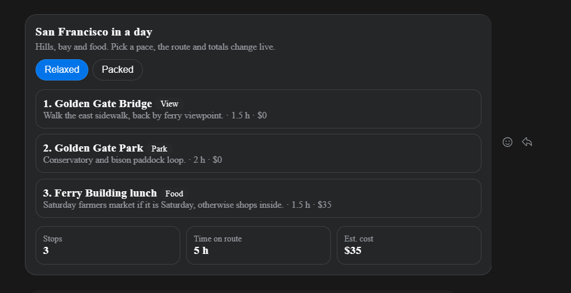
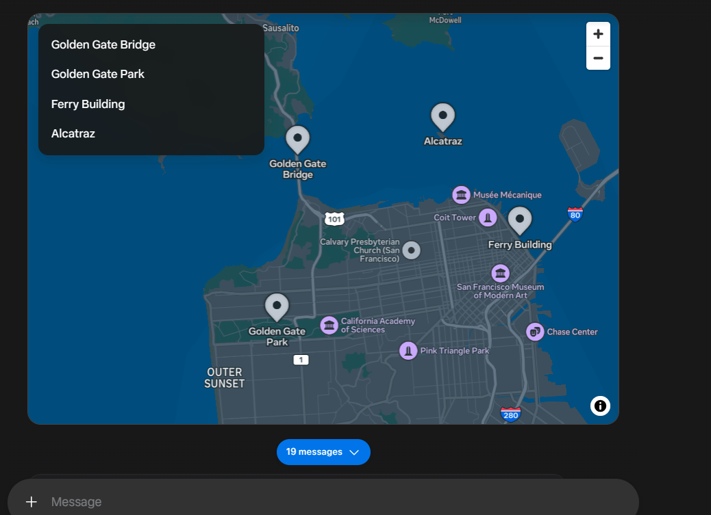

# ChatGPT Intelligent UI, now in Muse

Answer in Intelligent UI style, like thesysdev/open-intelligent-ui:
a composed interactive page instead of plain text. Maps for places,
charts and tables for numbers, SVG drawings for how-to, working
calculators, simulators and games for choices, photos for things with
a look. Short text plus a working card, never a checklist by default.

Independent skill, not affiliated with or endorsed by OpenAI or Thesys.
Source inspiration: https://github.com/thesysdev/open-intelligent-ui (MIT).

## Install in any Muse

Option 1, clone from GitHub:
```
git clone https://github.com/Sugamdeol/muse-intelligent-ui.git
cp -r muse-intelligent-ui ~/workspace/custom-skills/intelligent-ui
```
Then start a new chat. Muse discovers custom skills from that folder
automatically.

Option 2, copy the folder:
1. Copy the whole `intelligent-ui` folder (this folder, renamed to
   `intelligent-ui`) into your Muse workspace under
   `~/workspace/custom-skills/intelligent-ui/`
2. Restart or start a new chat. Muse discovers custom skills from that
   folder automatically.

Option 2, paste it in chat:
1. Open `SKILL.md` and paste its text into a chat with your Muse, and say:
   "Save this as my intelligent-ui skill and use it for every answer."
2. Your Muse will save it as a custom skill for you.

## Use it

Say any of these, or just ask a question that fits:
- "Answer in Intelligent UI style"
- "Make this a working tool"
- "Show it on a map" / "Show it as a chart" / "Show me how, step by step"

## What it changes

- Title, short text, then blocks. Facts as badges.
- Every slider, stepper or button changes something shown. No dead inputs.
- State lives in the widget bridge, totals and charts recompute live.
- Plain knowledge stays short text. No forced widget.
- If a widget preview fails on web, your Muse should fall back to a
  native list / map card or short text with the key numbers.

## Examples

San Francisco in a day, as a working route card plus a map, from the
skill's own demo:





## Files

- `SKILL.md` — the skill itself, the only file Muse needs.
- `references/widget-templates.md` — copy-ready patterns: calculator
  with chart, route page, step drawing, comparison table, flashcards,
  dashboard.
- `examples/` — screenshots of the skill in action.

License: MIT. You may copy, adapt and share this skill freely.
